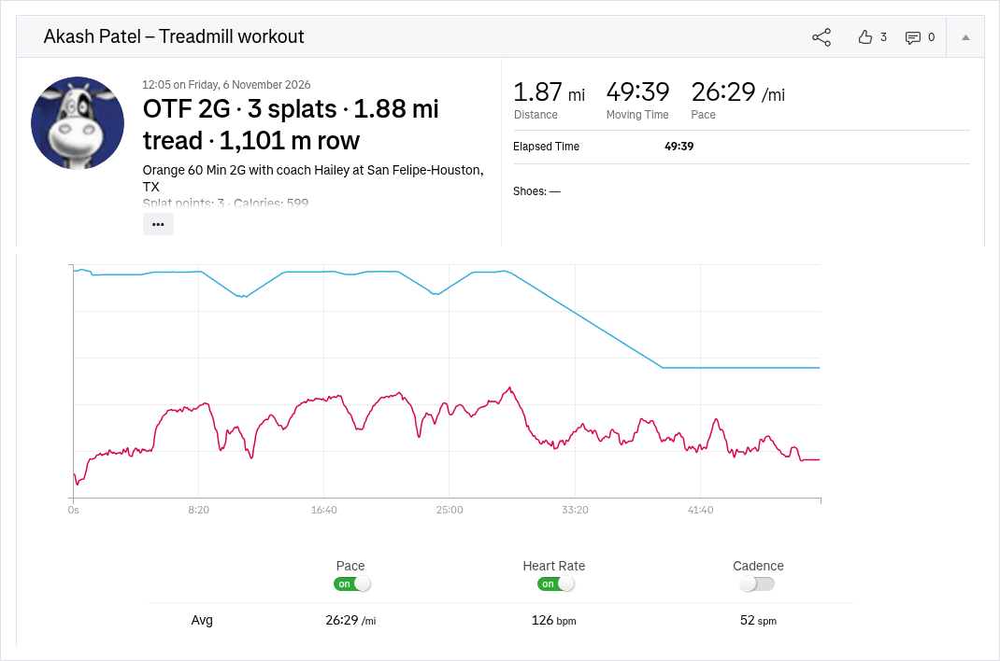

# OTF → Strava

Uploads each [Orangetheory Fitness](https://www.orangetheory.com/) class to [Strava](https://www.strava.com/) as one FIT activity, built from the class telemetry: real heart-rate charts, treadmill pace and incline, rower power and stroke rate, and a lap per station.



This is an unofficial, self-hosted tool. It is **not affiliated with, endorsed by, or associated with Orangetheory Fitness or Strava.** Orangetheory and Strava are trademarks of their respective owners. It fetches your workout data with the community [`otf-api`](https://github.com/NodeJSmith/otf-api) library (also unofficial) and uploads through the official [Strava API](https://developers.strava.com/). You run it with your own accounts, and you must create [your own Strava API application](https://www.strava.com/settings/api).

## What it does

- **Run (treadmill)** for any class with tread data, otherwise **Workout**.
- Distance is treadmill distance only (rower meters are never added). Speed is belt speed on the tread and 0 off it, so Strava can treat off-tread time as not moving.
- Synthetic elevation from treadmill incline.
- Rower watts become power, and strokes/min become cadence, on row blocks only.
- One lap per station block (tread / row / floor), detected from the telemetry.
- Titles look like `OTF 2G · 6 splats · 2.47 mi tread · 700 m row`. The description includes zones, splat points, calories, and coach.

### 3G classes and average pace

On 3G classes — and any class with row or floor blocks — Strava’s **overall average pace looks slower than you actually ran**. The activity covers the whole class, including time off the treadmill when the belt is stopped, and Strava folds that into the overall pace. This is more noticeable on 3G because a larger share of the class is off the tread.

Use the **Tread lap splits** on the Strava activity for your true run pace. Each upload already includes this note in the activity description. Rower power and stroke rate show on the row laps.

## Deduping and skips

The sync is stateless. A class is skipped only if Strava already has an activity *this tool uploaded* (`external_id` `otf-<id>`) within five minutes of the class start. Other overlapping activities are not treated as duplicates: they are logged and left untouched.

`python sync.py --dry-run --list-overlaps --days 60` lists non-sync activities that overlap your classes (useful before a backfill). If Strava rotates the refresh token, it is saved to `.env` locally; in GitHub Actions a warning asks you to update the secret. Classes with no heart-rate telemetry are skipped and retried on the next run; after 48 hours they produce a workflow warning. The tool never creates text-only or manual activities.

## Running the sync

### Option A: GitHub Actions (recommended)

1. Click [Use this template](https://github.com/kash04/otf-strava/generate) and create a **private** repository. A public fork will expose Actions logs (class times, titles, splat counts, and Strava activity IDs), so keep your copy private.
2. Create [your own Strava API application](https://www.strava.com/settings/api) with scope `activity:read_all,activity:write`. Do not reuse someone else’s credentials.
3. In your new repo, go to **Settings → Secrets and variables → Actions** and add: `OTF_EMAIL`, `OTF_PASSWORD`, `STRAVA_CLIENT_ID`, `STRAVA_CLIENT_SECRET`, `STRAVA_REFRESH_TOKEN`.
4. Done — the workflow runs a few times a day and syncs automatically.

Trigger it manually anytime from the **Actions** tab (you can pass `days`, `since`, or `dry_run`).

**Cron schedule:** The default is `15 13,14,15,23 * * *` UTC — 7:15, 8:15, 9:15 AM and 5:15 PM Central Standard Time (one hour later during daylight time). Edit `.github/workflows/sync.yml` so the job runs shortly after your usual class times; Orangetheory telemetry often appears a few minutes after class ends. A few runs a day stays well within GitHub’s 2,000 free Actions minutes for private repos.

The scheduled job is disabled on this public template repo itself, so it will not run here.

### Option B: Run locally

```
git clone https://github.com/kash04/otf-strava.git
cd otf-strava
python -m venv .venv && .venv/bin/pip install -r requirements.txt
```

Create a `.env` file (copy [`.env.example`](.env.example)):

```
OTF_EMAIL=your_otf_email
OTF_PASSWORD=your_otf_password
STRAVA_CLIENT_ID=your_client_id
STRAVA_CLIENT_SECRET=your_client_secret
STRAVA_REFRESH_TOKEN=your_refresh_token
```

Sample commands:

```
python sync.py --dry-run --days 30 --cache cache   # preview: write FIT files, no Strava calls
python sync.py --days 7                            # last 7 days
python sync.py --since 2026-01-01                  # classes on/after this date
python sync.py --only 2026-11-12                   # one class date (Central)
python sync.py --dry-run --list-overlaps --days 60 # list overlapping non-sync activities
```

`--dry-run --cache cache` writes FIT files to `out/` and a report to `out/report.json`. Drop `--dry-run` to upload.

## License

MIT
